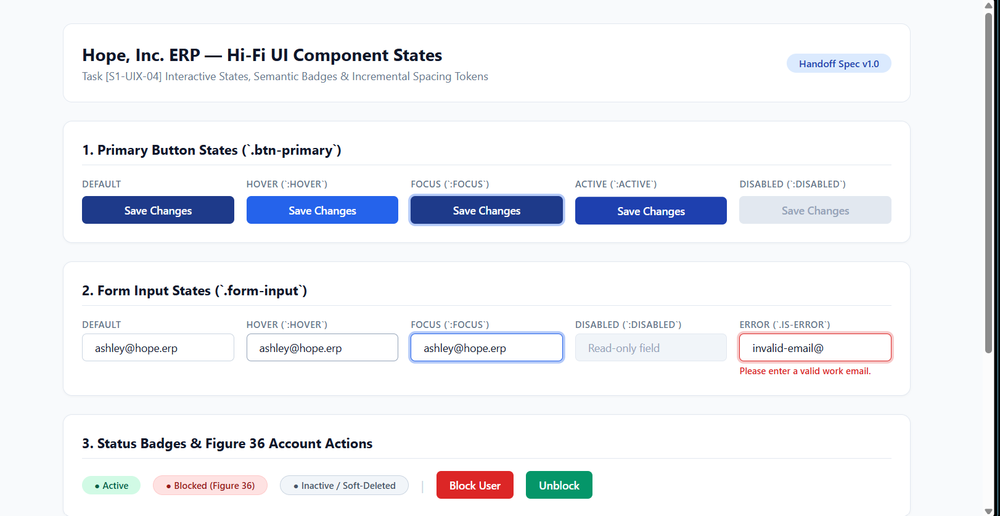
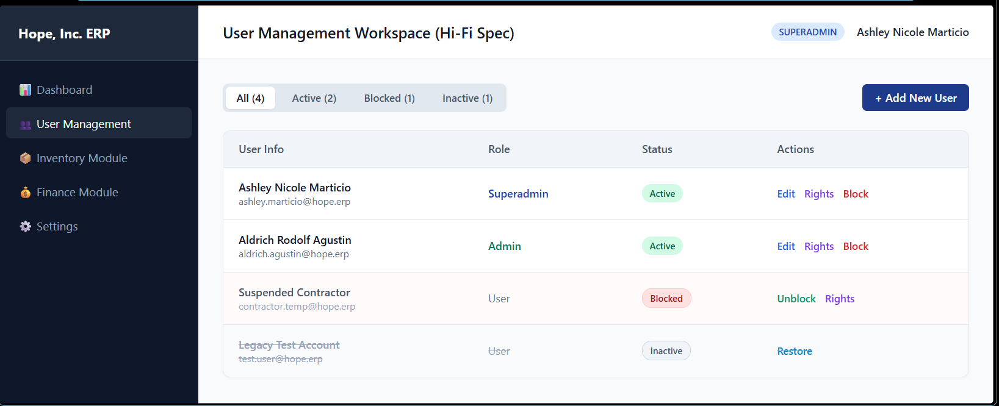

# Hope, Inc. ERP — Hi-Fi Mockups & Developer Handoff (Task S1-UIX-04)

## Summary
Implements task `[S1-UIX-04]` transitioning the Authentication, User Management, and Permissions Matrix wireframes into high-fidelity UI specifications, interactive state definitions, and backend/frontend handoff guidelines.

---

## Visual Assets

### 1. Interactive Component States & Spacing Tokens (`hifi/ui-states.html`)
- Demonstrates **Default, Hover, Focus, Active, Disabled, and Error** states for buttons and form inputs, along with the standardized spacing scale (`4px`, `8px`, `16px`, `24px`, `32px`).

### 2. High-Fidelity User Management & Blocked Flow (`hifi/user-management.html`)
- Implements **Figure 36 (Blocked User Flow)** with the red `Blocked` badge and dynamic `Unblock` action button, alongside shaded soft-deleted/inactive rows (`Restore` action) for Admin visibility.

---

## Developer Handoff Specifications

### 1. Incremental Spacing Scale
All layouts, card containers, form gaps, and table cells adhere to the following spacing tokens:
- `--space-1`: `4px` (Tight inline gaps, label-to-input spacing)
- `--space-2`: `8px` (Button padding vertical, compact tab gaps)
- `--space-4`: `16px` (Standard form grid gaps, horizontal button padding)
- `--space-6`: `24px` (Card internal padding, toolbar margins)
- `--space-8`: `32px` (Main canvas padding, section separation)

### 2. CSS Classes & Interactive States
| Component / State | CSS Class / Selector | Key Visual Rules |
| :--- | :--- | :--- |
| **Primary Button** | `.btn-primary` | Default `#1E3A8A`, Hover `#2563EB`, Active `#1E40AF`, Focus `0 0 0 3px rgba(37, 99, 235, 0.35)` |
| **Disabled State** | `:disabled` / `.is-disabled` | Background `#E2E8F0` / `#F1F5F9`, Text `#94A3B8`, `cursor: not-allowed` |
| **Input Error State** | `.form-input.is-error` | Border `#DC2626`, Focus ring `0 0 0 3px rgba(220, 38, 38, 0.25)` + inline `.error-text` |
| **Blocked Status Badge** | `.badge-blocked` | Background `#FEE2E2`, Text `#991B1B`, Border `1px solid #FECACA` |
| **Soft-Deleted Row** | `tr.soft-deleted` | Background `#F8FAFC`, muted `#94A3B8` strikethrough text, paired with `.btn-restore` |

### 3. Desktop Viewport Responsiveness
- Verified across standard desktop resolutions (**1920×1080** and **1366×768**) with fixed `260px` sidebar navigation, sticky `70px` top header, and fluid table containers without horizontal overflow.

### 4. Backend Integration Notes (`@rickysanglay`)
- **Block / Unblock Flow (Figure 36):** Toggling a user's blocked state should update the user record status (`Active` $\leftrightarrow$ `Blocked`) and dynamically swap the UI action between `.btn-block` and `.btn-unblock`.
- **Soft-Delete Visibility:** Admin table queries should include soft-deleted/inactive accounts (e.g., `is_deleted = true` or `status = 'Inactive'`) so Admins can trigger the `Restore` endpoint.
- **UI Copy Alignment:** All button labels, status badges, and validation helper messages match the Hope, Inc. ERP Student Guide screens (Figures 2–8, 35–40).