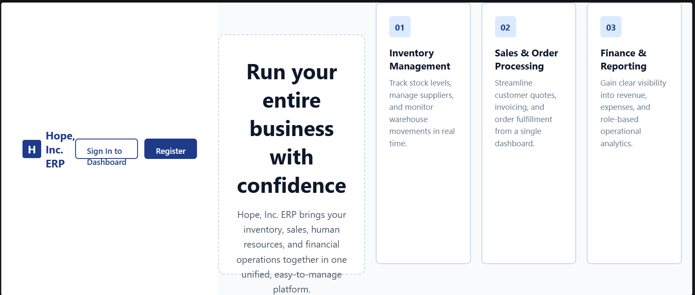
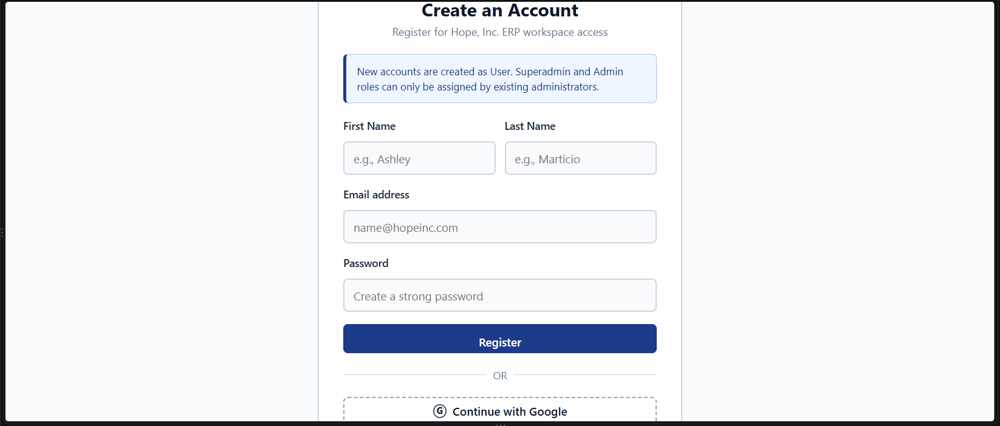
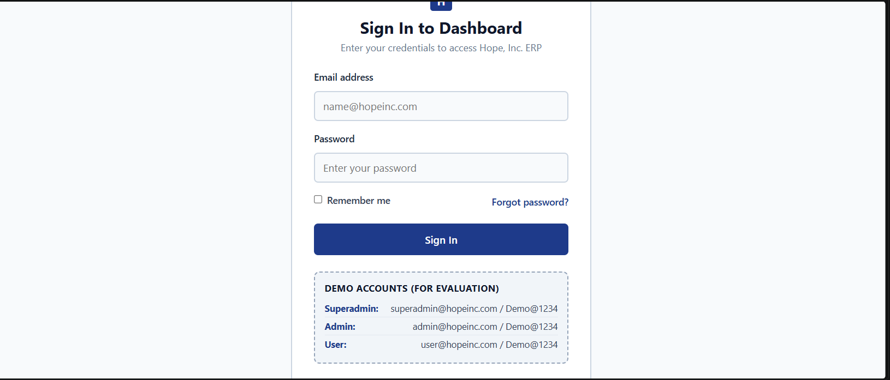
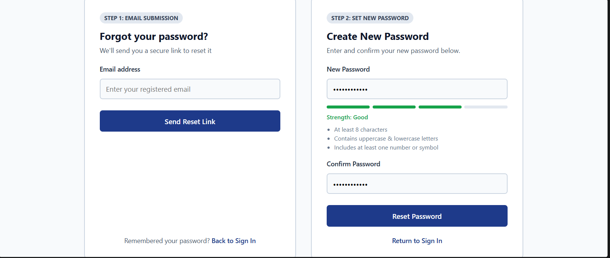

# S1-UIX-02: Public Visitor & Authentication Wireframes

## Overview
Low-to-medium fidelity wireframes for the Hope, Inc. ERP public landing page and authentication flows, built using the design tokens and typography rules defined in `S1-UIX-01`.

---

## Figure 2: Public Landing Page

- **Hero Headline:** "Run your entire business with confidence"
- **CTAs:** "Sign In to Dashboard", "Register"
- **Features:** Core ERP module preview cards.

## Figure 3: Registration Modal / Page

- **Role Notice Banner:** "New accounts are created as User. Superadmin and Admin roles can only be assigned by existing administrators."
- **Fields:** First Name, Last Name, Email address, Password.
- **Actions:** Register button, "Continue with Google" placeholder, Sign In navigation link.

## Figure 4: Login Modal / Page

- **Fields & Controls:** Email address, Password, "Remember me" checkbox, "Forgot password?" link.
- **Demo Accounts Box:** Evaluation credentials callout.

## Figure 5: Forgot & Reset Password Flows

- **Email Submission:** Email input with helper copy: *"We'll send you a secure link to reset it"*.
- **New Password Entry:** New password and confirm password fields with password strength indicator.