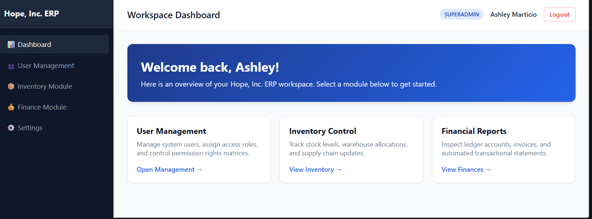
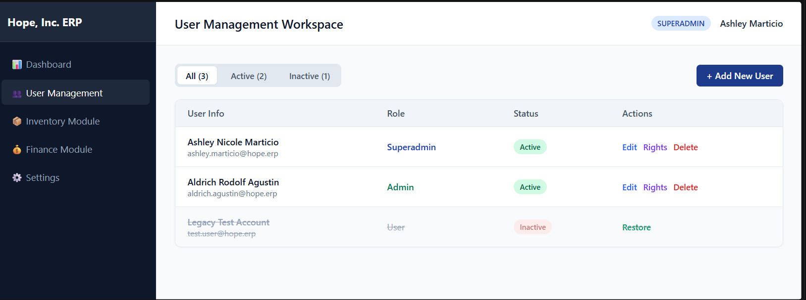
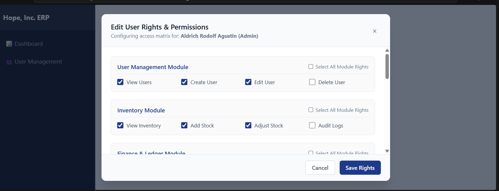

# Hope, Inc. ERP - Workspace Wireframes (Task S1-UIX-03)

## Summary
Implements task `[S1-UIX-03]` covering the Main Workspace Shell, User Management Data Table, and the User Rights/Permissions Modal Dialog. All designs strictly follow the design tokens from `S1-UIX-01`.

---

## Visual Assets

### Figure 6: Main ERP Workspace Shell (`dashboard.html`)
- Features the sticky top header, collapsible dark sidebar (`#0F172A`), role indicator badge, and responsive landing dashboard canvas.

### Figure 7: User Management Table (`user-management.html`)
- Includes live-count status tabs, search toolbar, primary action buttons, status badges (`Active`/`Inactive`), and the shaded soft-deleted row state with a `Restore` action button.

### Figure 8: User Rights & Permissions Modal Dialog (`user-rights-modal.html`)
- Features the centered modal overlay, scrollable permission body, sticky footer actions, and the full 36-checkbox granular permission matrix.

---

## Notes & Verification
- Cross-navigation links between the dashboard, user table, and rights modal have been fully verified locally across browser viewports.